[中文](README.md) | [English](README.en.md)

# SignageHub · 知华科技数字标牌与播放器

知华科技（上海如静知华信息科技有限公司） · https://www.zhuatech.cn/ · 微信 zhuatech / zhuatech2

把图片、短视频和文字编排成节目，投放到门店、展厅或接待区的屏幕。后台维护素材、分组、节目草稿和限时排期；电脑播放器将完整节目缓存到本机，校验后切换，在内容后台断网时沿用有效缓存。

**公开源码学习版／源码公开、非商业使用。** 仅限个人学习交流，未经上海如静知华信息科技有限公司书面授权不得商用，见[LICENSE](LICENSE)。适合小型屏幕网络及软件实施研究；外部采用、付费与生产容量尚未验证。

## 从素材到屏幕

|使用端|已实现的业务|
|---|---|
|内容编辑后台|PNG/JPEG与H.264/AAC MP4上传、格式/尺寸/配额检查、素材预览与启停；有序图片、视频、文字节目编辑；中英文名称、内容类别、横/竖画布、适配和颜色|
|发布与设备后台|组织内屏幕、分组、独立设备令牌；立即更新常驻节目、限时排期、重叠拒绝、撤销、不可变版本与常驻回滚；目标版本和实际播放分别记录|
|电脑播放器|Node本地服务、浏览器播放界面、文件SHA-256检查、磁盘缓存、完整下载后原子激活、断网排期与租期、重启缓存恢复、崩溃后进程守护、受限本机设置页|
|管理与审计|BCrypt12、会话/CSRF、登录限制、密码修改和旧会话撤销、账号/角色/权限、组织范围、菜单、字典和参数、审计、搜索筛选分页、运行报表CSV|

发布时冻结内容与目标屏幕。编辑草稿不会悄悄改写已发布节目；相同请求可恢复同一次发布，旧版本保存被拒绝。限时节目按服务器UTC时段优先生效，结束后恢复屏幕常驻节目；排期由本机缓存中的时段切换，不依赖浏览器持续连接后台。

电脑播放器接收常驻节目及未来七天排期，全部素材校验后才激活。断网最长播放期限由系统参数控制，范围1–72小时；授权过期、缓存损坏或时钟明显回退时停止。设备停用/令牌失效在重新联网后清除本机播放授权；已离线设备在租期内继续使用已授权缓存，无法承诺断网立即撤销。详见[业务规则](docs/BUSINESS.md)和[操作手册](docs/OPERATIONS.md)。

## 实际运行页面

下列截图来自本系统运行界面。带QA的内容仅用于独立验收，空库安装不插入这些业务数据；截图不展示设备令牌、密码或客户资料。测试环境使用独立端口，Compose默认后台端口为8170，可按配置调整。

|页面|功能|
|---|---|
|登录|岗位账号进入内容后台|
|素材库|真实图片/视频及已验证尺寸|
|节目编辑|有序媒体、文本与画布设置|
|屏幕管理|设备、分组和常驻节目|
|发布排期|冻结版本、目标与时间|
|运行概况|连接及实际播放状态|
|权限|账号岗位和管理范围|
|电脑播放器|缓存状态和实际播放画面|

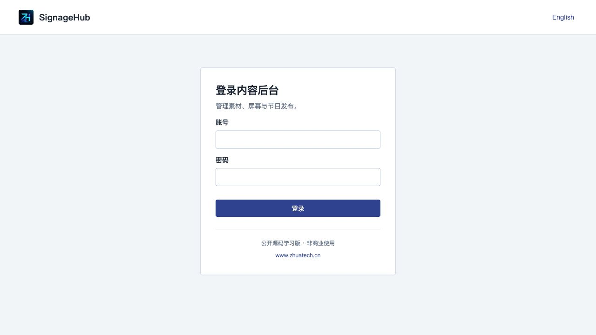
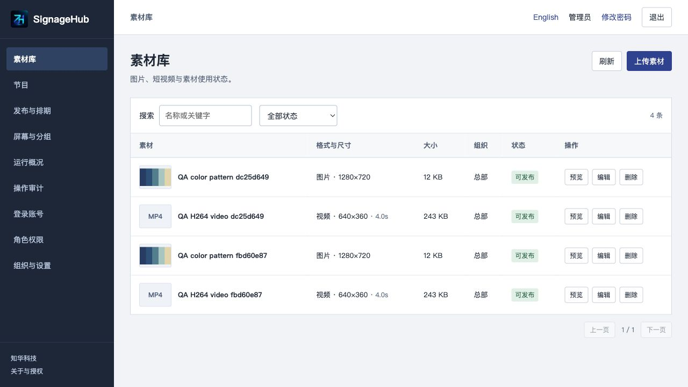
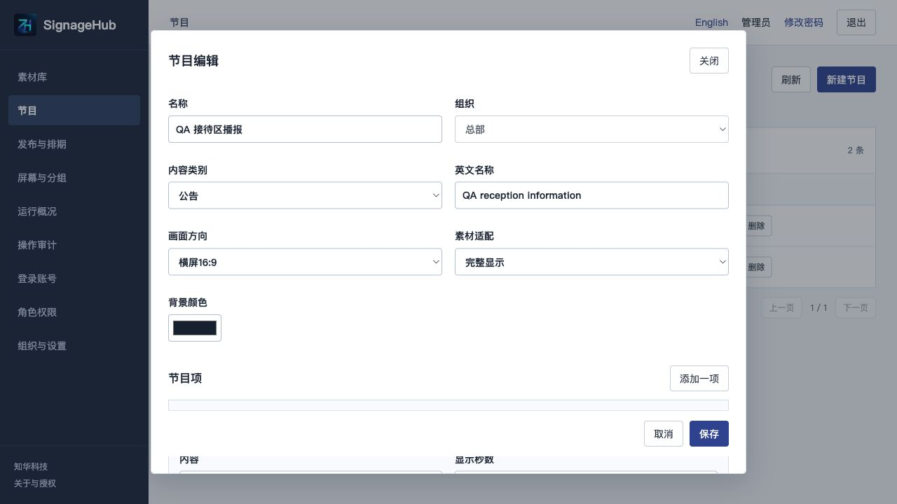
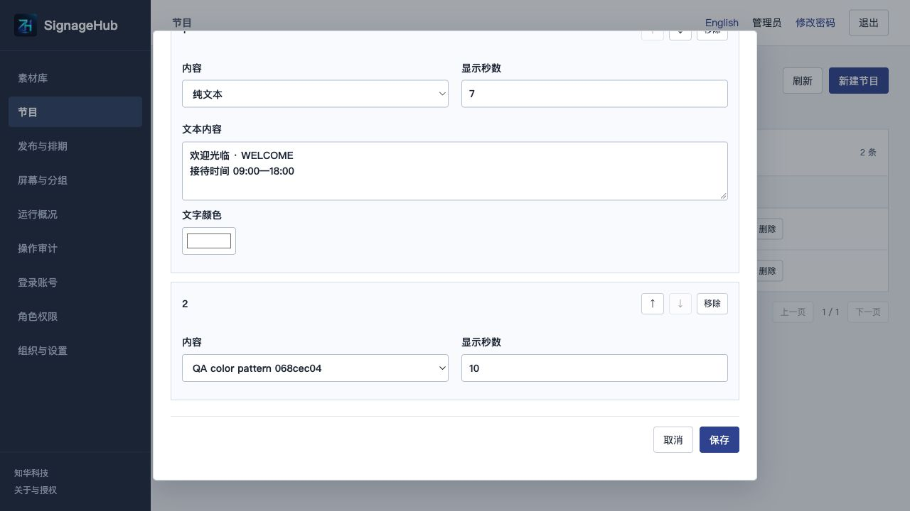
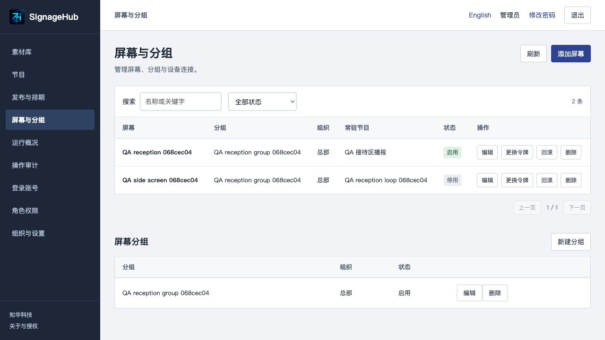
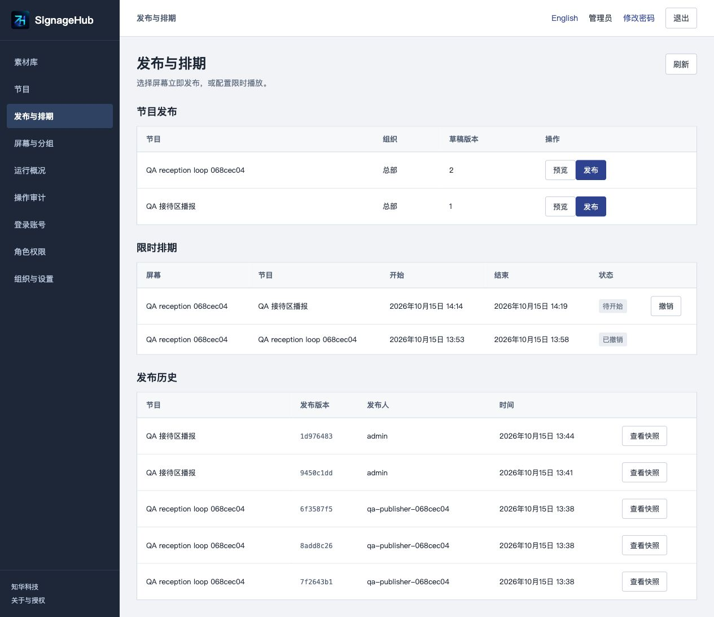
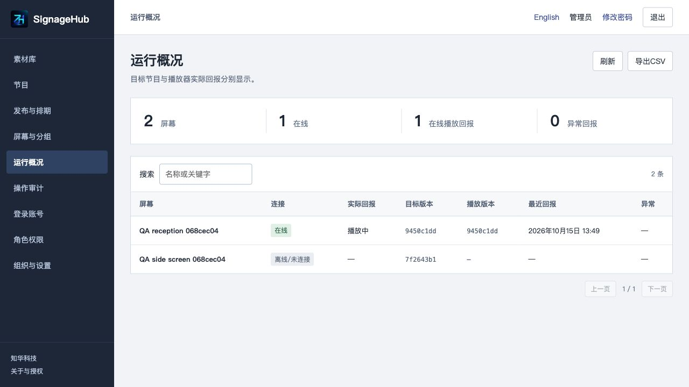
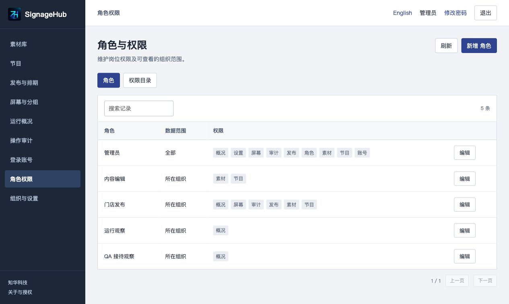
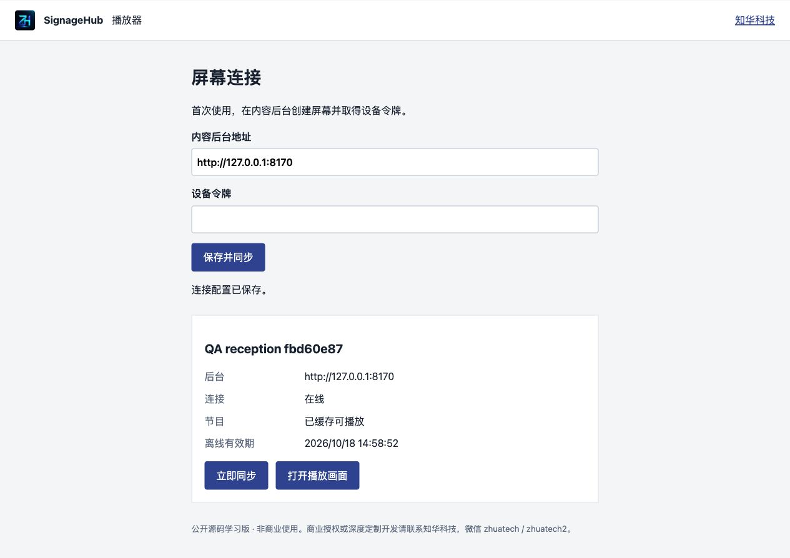
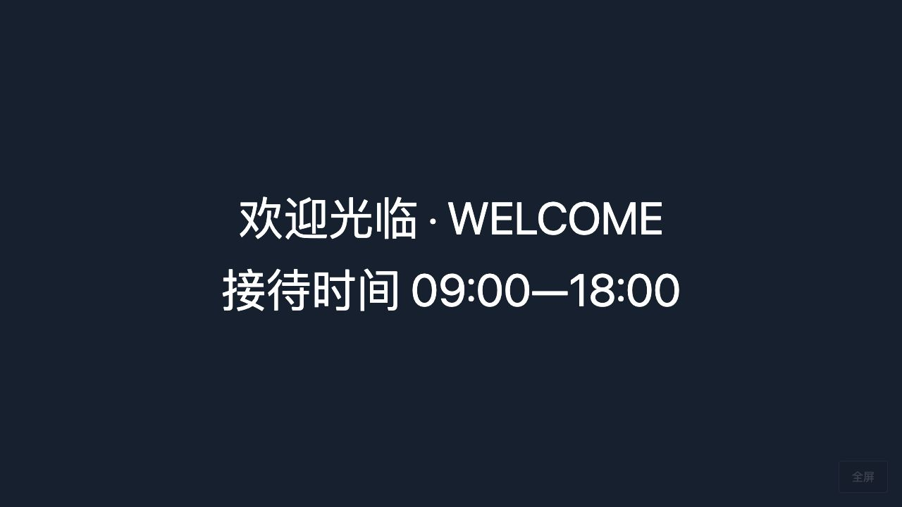

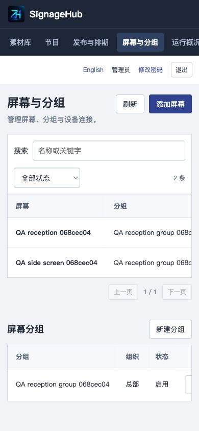
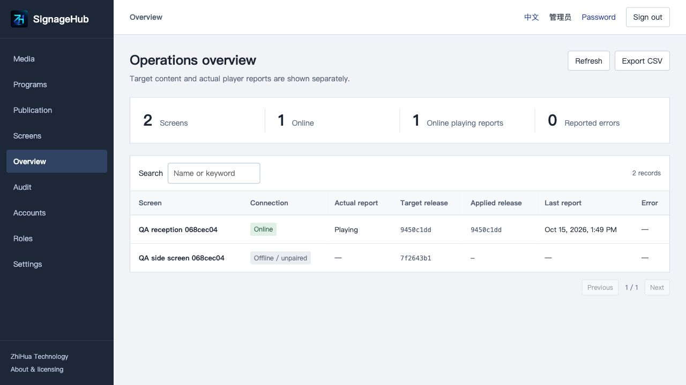

## 工程、架构与环境

内容后台浏览器 → Nginx同源API → Spring Security及组织范围 → 业务事务 → MySQL；媒体文件保存在独立卷。设备使用独立令牌获取节目与媒体，令牌只在设备本机私有配置中保存，后台数据库仅保留摘要。

Java21、Spring Boot4.0.7、Security/JPA/Flyway、MariaDB Connector/J3.5.10连接MySQL8.4；Vue3.5.43、Vite8.1.5、Node24.19.0、Nginx1.29。视频服务调用发行版ffprobe检查编码及尺寸，第三方许可独立保留。

```text
backend/                身份、媒体校验、节目、发布、排期和设备API
  src/main/resources/   应用配置、Flyway V1/V2数据库迁移
frontend/               内容、设备、发布及管理界面
  public/brand/         正式LOGO和两个原始微信二维码
player/                 Node电脑播放器、磁盘缓存、本机页面与进程守护
scripts/                私有初始化、验收、持久化复核、备份恢复、启动文件生成
docs/                   操作、API、安全、部署、测试、第三方许可及运行截图
compose.yaml            持久MySQL、媒体卷、后端、前端
compose.test.yaml       独立临时MySQL测试，不能并入生产
```

服务端需要Docker及Compose v2、Python3.10+，建议至少4GB可用内存；源码调试还需JDK21、Maven3.9、Node≥24.19。电脑播放器需要Node≥24.19和现代浏览器；播放设备须有足够磁盘空间保存缓存，单屏总素材最多256MB。

## 安装和第一次发布

```sh
git clone https://github.com/zhuatech-han/zhuatech-signagehub.git
cd zhuatech-signagehub
python3 scripts/init-env.py
docker compose -p signagehub config --quiet
docker compose -p signagehub up --build -d --wait --wait-timeout 3600
python3 scripts/readiness.py
```

访问[本机后台](http://127.0.0.1:8170/)及[健康检查](http://127.0.0.1:8170/actuator/health)。账号默认为`admin`，独立强密码在私有`.env`的`ADMIN_PASSWORD`；没有固定共享密码。初始化文件权限0600且拒绝覆盖，重启不会重置已有账号。

登录后：上传素材 → 保存节目 → 添加屏幕并保存仅显示一次的令牌 → 向屏幕发布 → 在播放电脑连接后台。首次空库只初始化身份、角色、权限、组织、菜单、内容类别及参数，不造门店、屏幕或业务节目。

```sh
cd player
node src/launcher.js
```

在播放电脑打开[本机设置](http://127.0.0.1:8171/)，输入可达的HTTPS后台根地址及设备令牌，再打开[播放界面](http://127.0.0.1:8171/display)。同机调试允许`http://127.0.0.1:8170`；其他电脑上的localhost指向它自己，不能填服务器的localhost地址。运行播放器不需要安装npm依赖；npm依赖只用于代码检查与测试。

本机设置只监听127.0.0.1，设备令牌不会进入播放网址、浏览器存储或运行日志。`player-data/`持有0600配置与缓存状态，目录0700，勿分享或提交。设置页用于配对与核对状态，播放页用于展示内容。

内容后台可切换中英文；播放器设置页当前为中文，节目文字可以自行编辑为其他语言。

## 数据库、配置及升级

[V1身份结构](backend/src/main/resources/db/migration/V1__identity.sql) → [V2标牌业务](backend/src/main/resources/db/migration/V2__signage.sql)。Flyway版本化迁移与JPA结构校验同时启用；升级应先备份，再更新镜像并等待迁移，不能修改已执行迁移文件。主部署使用READ COMMITTED事务隔离和组织写锁，避免并发发布与陈旧草稿覆盖。

|配置|用途|
|---|---|
|DATABASE_PASSWORD、MYSQL_ROOT_PASSWORD|独立数据库凭据，不暴露数据库端口|
|ADMIN_USERNAME、ADMIN_PASSWORD|首次管理员；已有账号不被覆盖|
|BIND_ADDRESS、WEB_PORT|默认127.0.0.1:8170，可覆盖端口|
|COOKIE_SECURE|外部HTTPS部署设为true|
|TEST_DATABASE_PASSWORD、TEST_ROOT_PASSWORD|隔离测试数据库，不能用生产凭据|
|PLAYER_DATA_DIR、PLAYER_PORT|播放器私有目录和本机端口，默认player-data及8171|
|PLAYER_POLL_MS|同步间隔，默认15000毫秒，最少5000|

账号内系统参数`offlineHours`决定后续设备租期，1–72小时；`screenLimit`限制每组织屏幕数量，1–500。每组织媒体最多512MB；单文件64MB，图片最大4096×4096，MP4最大1920×1920且300秒，只接受H.264视频及AAC音频。发布和节目项最多100项；节目列表等有10000条目录上限，界面分页15条，不承诺大规模屏幕网络。

## 测试、部署与恢复

```sh
cd frontend
npm ci --no-audit --no-fund
npm run format:check
npm run lint
npm test
npm run build
cd ../player
npm ci --no-audit --no-fund
npm run format:check
npm run lint
npm test
cd ../backend
mvn -B spotless:check test
cd ..
docker volume create signagehub-maven-cache
docker compose -f compose.test.yaml -p signagehub-quality up --abort-on-container-exit --exit-code-from tests
```

后端38项单元/集成测试覆盖不可变发布、权限、会话、相邻排期、重叠拒绝、回滚和并发；前端14项请求/CSRF/未知结果及目录并发读取测试；播放器24项含真实本机HTTP、校验、离线租期、缓存损坏、范围请求、重启及守护恢复。当前验收结果见[测试说明](docs/TESTING.md)，未执行的环境不能视为通过。Docker Maven构建不跳过测试。

仅在独立本机测试部署运行`python3 scripts/quality.py --project signagehub --video`，会创建明确的QA资料和私有`output/`验收状态；不对生产部署执行。持久化复核用`python3 scripts/verify-persistence.py`。

后台上传与数据库写入暂停后，可同时备份SQL和素材卷：

```sh
python3 scripts/backup.py --project signagehub --output /private/path/signagehub-backup.zip
python3 scripts/restore-env.py --source .env --output /private/path/restore.env --port 8172
python3 scripts/restore.py /private/path/signagehub-backup.zip --project signagehub-restore --env-file /private/path/restore.env
```

恢复仅接受可信备份和新的空项目/卷，使用独立本机端口；检查ZIP/TAR路径、大小、类型及摘要。备份不包含`.env`或播放器的配对配置；部署者须另行安全保留必要环境文件。每个归档成员上限1GB。[部署说明](docs/DEPLOYMENT.md)包括HTTPS、升级、启动文件生成与备份恢复。

## 限制与常见问题

- 电脑播放器及后台均为完整源码，可手动启动使用。macOS、systemd、Windows登录启动文件生成器已提供；操作系统登录/重启、浏览器无人值守启动、电视电源/HDMI、Android原生APK、Windows/Linux实机和专用电视型号仍需单独验收，不能据此宣称全设备兼容。
- 播放器默认静音，H.264视频由浏览器解码；没有视频转码、自由拖拽多区域编辑、网页嵌入、POS/ERP现成连接器、设备远程关机/重启、广告计费、多租户SaaS或生产容量认证。
- 登录失败先核对私有.env的管理员初始化信息；已有账号应由授权管理员重置。视频拒收需核对容器中的ffprobe及编码/尺寸；不把不支持的文件伪装成已可播放。
- 目标版本不等于实际已播放：只有本机渲染器回报后才显示“播放中”。连接失败沿用有效缓存；租期到期必须联网续期。时钟回退、缓存损坏或本机服务停止时显示明确状态。
- 媒体停用阻止新发布，历史快照继续保留；引用中的文件不能删除。有发布历史的屏幕/节目保留，屏幕用停用管理。离线缓存的撤销边界见上文。
- 暂无历史版本归档及素材空间自动回收。历史引用仍计入组织512MB配额，持续更新大量视频的场景需扩展保留策略。视频上传检查元数据和编码，实际解码仍需在目标播放电脑验收。
- 无公网演示站、真实客户或付款案例。安全报告、维护责任、数据备份及部署环境仍需由使用者审查。[安全说明](docs/SECURITY.md)

## 联系、授权和贡献

商业授权或深度定制开发请联系知华科技；提供源码授权、私有化部署、软件实施、设备适配和系统集成咨询。官网：[https://www.zhuatech.cn/](https://www.zhuatech.cn/)，微信`zhuatech`、`zhuatech2`。

本项目由知华科技（上海如静知华信息科技有限公司）提供公开源码学习版本，主要用于个人学习、技术研究与非商业交流。未经书面授权不得商用。企业信息化建设、中小企业数字化转型、中小企业 AI 转型、私有化部署、软件外包、软件项目外包、软件实施、FDE 外包、OPC 技术支持及深度定制开发，请访问知华科技官网 https://www.zhuatech.cn/，或添加微信 zhuatech、zhuatech2 咨询。

<table>
<tr><td align="center" valign="middle"></td><td align="center" valign="middle"></td></tr>
<tr><td align="center">微信：zhuatech</td><td align="center">微信：zhuatech2</td></tr>
</table>

问题反馈请在Issues附脱敏复现步骤、版本和环境；漏洞请通过官网咨询入口私下反馈，不公开密钥。贡献应提供业务说明与相关测试，保留公司署名和第三方版权。[第三方说明](docs/THIRD_PARTY.md)中的许可独立适用，知华非商业要求不覆盖第三方组件。项目按现状提供，使用和部署前应自行验证适配、安全与适用范围。
